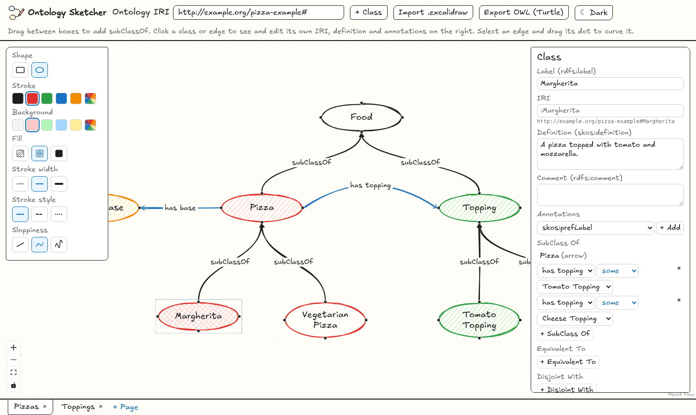

<p align="center">
  <picture>
    <source media="(prefers-color-scheme: dark)" srcset="docs/logo-dark.svg">
    
  </picture>
</p>

# Ontology Sketcher

**Sketch an ontology like a whiteboard drawing, and get real OWL 2 out of it.**

Ontology Sketcher is a browser-based ontology editor with the hand-drawn look of Excalidraw and the modelling
depth of Protégé. Draw classes as boxes or ovals, connect them with arrows, refine them in an inspector, and export
valid OWL 2 in Turtle.


## Why

Ontologies usually start on a whiteboard, then get rebuilt by hand in a tool like Protégé. Ontology Sketcher
keeps the whiteboard: the drawing *is* the ontology. You can import an existing Excalidraw sketch, tidy it up,
add axioms, and export something a reasoner accepts.

## Features

**A canvas that feels like a whiteboard**

- Hand-drawn shapes and the Excalifont handwriting font, with a style panel like Excalidraw's: stroke and fill
  colours, fill style, stroke width and style, and sloppiness.
- Every class has four connection dots. Drag from one onto another class to add `rdfs:subClassOf`; the arrow
  snaps to the nearest dot.
- Name an arrow to turn it into an object property. Drag an arrow's midpoint to curve it.
- Pages, like layers: split a large ontology into views that share the same classes, and pick which pages to
  export.

**Import from Excalidraw**

- Open an `.excalidraw` file and labelled shapes become classes in the same place. Arrows between them become
  `rdfs:subClassOf` (unlabelled, or labelled "SCO" / "subClassOf") or an object property named after the label.
- Colours, fill, stroke, sloppiness and curved arrows carry over.

**Protégé-style editing in the inspector**



- Labels, IRIs, `skos:definition`, `rdfs:comment` and any other annotation (SKOS, Dublin Core or your own), with
  language tags.
- Class axioms laid out like Protégé's class description: SubClass Of, Equivalent To and Disjoint With, written
  in Manchester order with `some`, `only`, `min`, `max` and `exactly`.
- Object property characteristics (functional, inverse functional, transitive, symmetric, asymmetric, reflexive,
  irreflexive), inverses and super properties.
- Data properties on classes with an `xsd` datatype.

**OWL 2 export**

- One click exports Turtle. The output has been checked with [ROBOT](https://robot.obolibrary.org) and the HermiT
  reasoner: it stays inside OWL 2 DL.
- Properties drawn between several class pairs get a union domain and range, so reusing a property doesn't make
  the reasoner draw conclusions you never drew.

<details>
<summary>The Turtle exported from the drawing above (excerpt)</summary>

```turtle
@prefix : <http://example.org/pizza#>.

:Margherita a owl:Class;
    rdfs:label "Margherita";
    skos:definition "A pizza topped with tomato and mozzarella.".
:Margherita rdfs:subClassOf [
  a owl:Restriction;
  owl:onProperty :hasTopping;
  owl:someValuesFrom :TomatoTopping
], [
  a owl:Restriction;
  owl:onProperty :hasTopping;
  owl:someValuesFrom :CheeseTopping
].
:Margherita rdfs:subClassOf :Pizza.
:hasTopping a owl:ObjectProperty;
    rdfs:label "has topping".
:hasTopping rdfs:domain :Pizza;
    rdfs:range :Topping.
```

</details>

## Try it

```sh
git clone https://github.com/skhella/ontology-sketcher.git
cd ontology-sketcher
npm install
npm run dev
```

Open the address Vite prints. The editor starts with a small pizza example. To get the drawing from the screenshots,
click **Import .excalidraw** and pick [`docs/pizza-example.excalidraw`](docs/pizza-example.excalidraw).

## Roadmap

- SHACL shapes: defining and validating them alongside the ontology.

## Built with

[React Flow](https://reactflow.dev) for the graph canvas, [rough.js](https://roughjs.com) for the hand-drawn shapes,
[Excalifont](https://plus.excalidraw.com/excalifont) for the lettering and [N3.js](https://github.com/rdfjs/N3.js)
for Turtle. Vite, React and TypeScript underneath.

## Develop

```sh
npm run dev     # start the editor
npm test        # run unit tests
npm run build   # type-check and build
npm run lint    # lint with oxlint
```

## License

The code is under the [MIT License](LICENSE). The bundled Excalifont is under the SIL Open Font License 1.1
([licence text](public/fonts/excalifont/OFL.txt)); Shantell Sans, the fallback font, is also OFL-1.1.

Ontology Sketcher is an independent project. It is not affiliated with or endorsed by Excalidraw; it borrows
the look and uses the openly licensed Excalifont.
