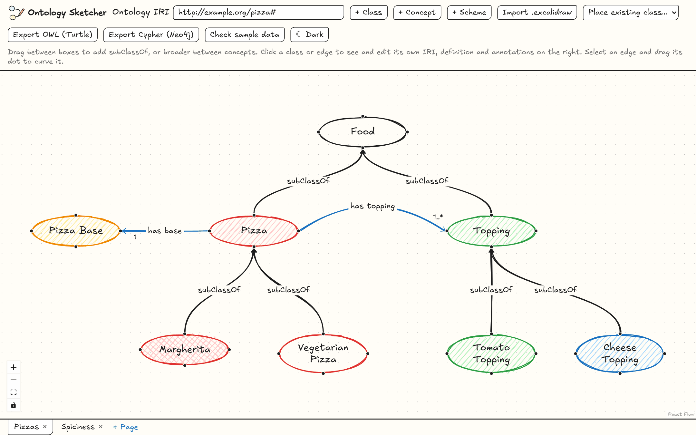
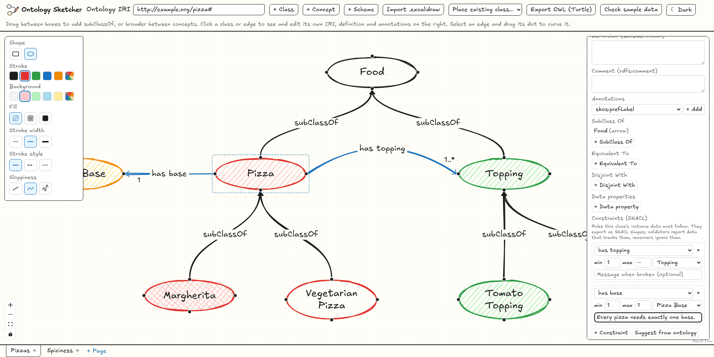
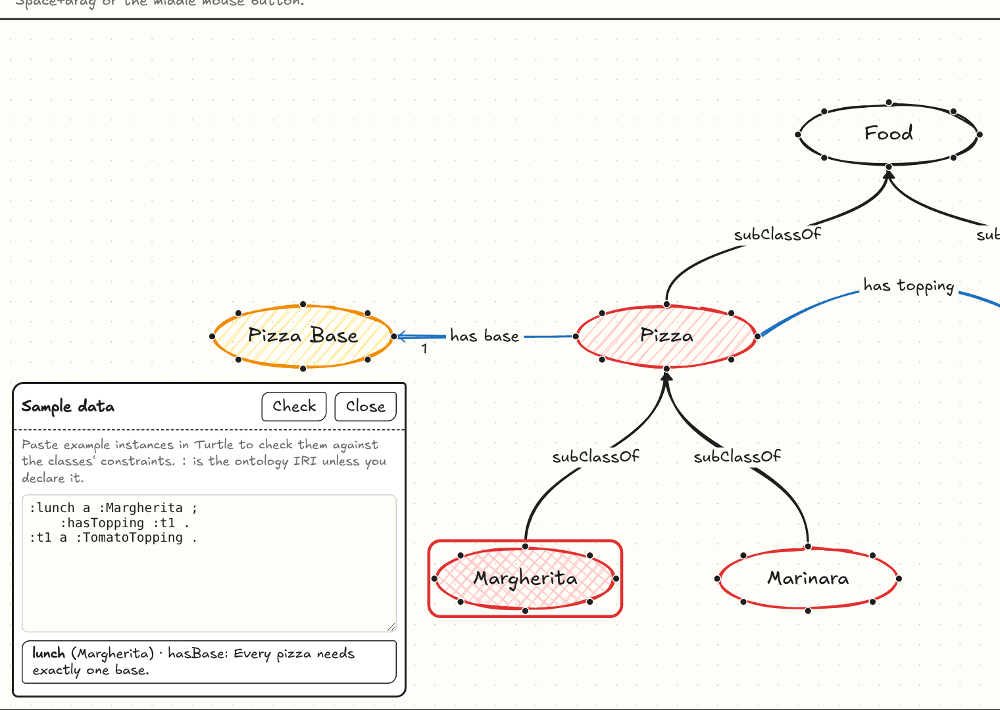
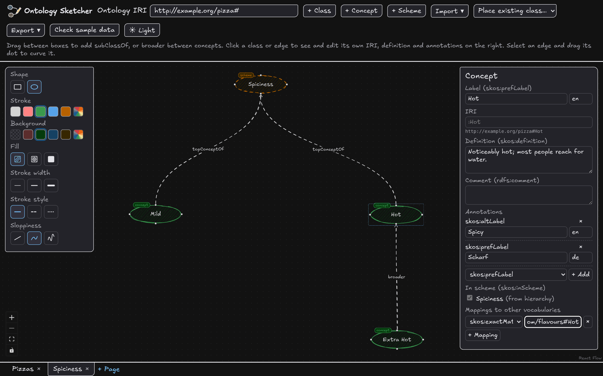
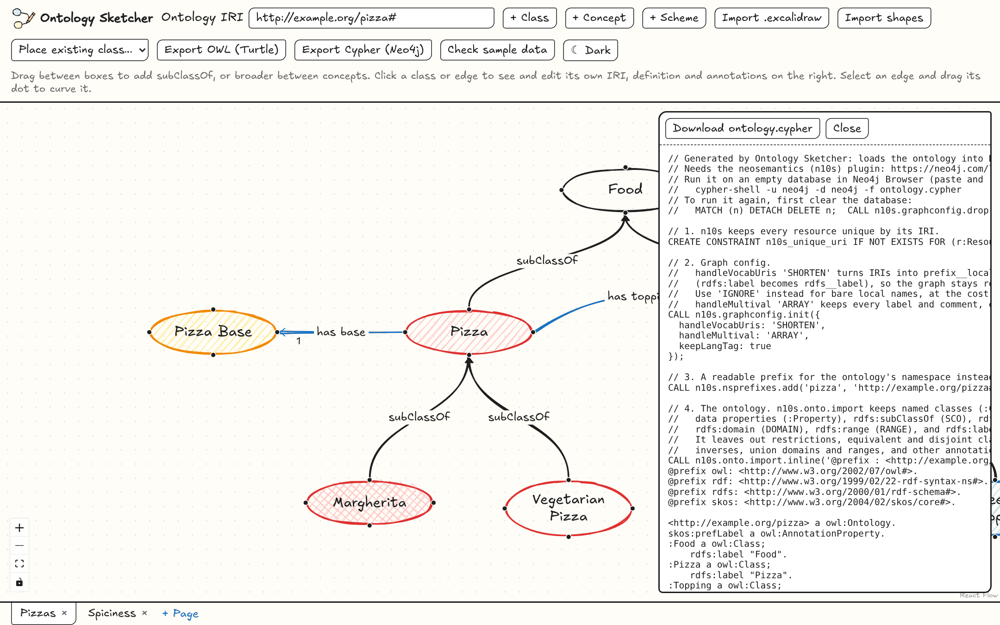

<p align="center">
  <picture>
    <source media="(prefers-color-scheme: dark)" srcset="docs/logo-dark.svg">
    
  </picture>
</p>

<h1 align="center">Ontology Sketcher</h1>

<p align="center">
  <strong>Sketch an ontology like a whiteboard drawing, and get real OWL 2, SHACL and SKOS out of it.</strong>
</p>

<p align="center">
  <a href="LICENSE"></a>
  
  
  
  
</p>

Ontology Sketcher is a browser-based ontology editor with the hand-drawn look of Excalidraw and the modelling
depth of Protégé. Draw classes as boxes or ovals, connect them with arrows, refine them in an inspector, add
rules for your data, and export clean Turtle that a reasoner, a SHACL validator and Neo4j can all load.



## Why

Ontologies usually start on a whiteboard, then get rebuilt by hand in a tool like Protégé. Ontology Sketcher
keeps the whiteboard: the drawing *is* the ontology. You can start from an existing Excalidraw sketch or Turtle file, tidy it up,
add axioms and data constraints, check a few example instances, and hand the result to the rest of your stack.

| Sketch | Model | Validate | Ship |
| --- | --- | --- | --- |
| Draw classes and arrows on a hand-drawn canvas, or import a Turtle ontology or an `.excalidraw` file. | Annotations, class axioms and property characteristics in a Protégé-style inspector. | SHACL constraints per class, checked against sample data right in the app. | `ontology.ttl`, `shapes.ttl`, a Cypher script for Neo4j and an SVG image. |

## Features

### A canvas that feels like a whiteboard

- Hand-drawn shapes and the Excalifont handwriting font, with a style panel like Excalidraw's: box or oval,
  stroke and fill colours, fill style, stroke width and style, and sloppiness.
- Light and dark mode, following your system setting until you pick one in the toolbar.
- Every class has four connection dots. Drag from one onto another class to add `rdfs:subClassOf`; the arrow
  snaps to the nearest dot. Name an arrow to turn it into an object property, and drag its midpoint to curve it.
- Pages, like layers: split a large ontology into views that share the same classes, and pick which pages to
  export.
- Your work is autosaved in the browser and comes back when you reload. **Project > Save project** (or Ctrl+S)
  downloads everything, every page and position included, as one `.sketcher.json` file that **Open project** reads
  back; **New project** starts over on an empty page.
- **Import an ontology** in Turtle (`.ttl`), for example one you exported here or saved from Protégé or GraphDB.
  Classes, the subclass hierarchy, object and data properties, class axioms, annotations and SKOS concepts come
  back onto the canvas with an automatic layout, superclasses above subclasses. Classes already on the page keep
  their place, so re-importing an edited file only adds what is new.
- **Import an .excalidraw drawing**: labelled shapes become classes in the same place, and arrows between them become
  `rdfs:subClassOf` (unlabelled, or labelled "SCO" / "subClassOf") or an object property named after the label.
  Colours, fill, stroke, sloppiness, ovals and curved arrows carry over.

### Protégé-style modelling in the inspector

- Labels, IRIs, `skos:definition`, `rdfs:comment` and any other annotation (SKOS, Dublin Core or your own), with
  language tags.
- Class axioms laid out like Protégé's class description: SubClass Of, Equivalent To and Disjoint With, written
  in Manchester order with `some`, `only`, `min`, `max` and `exactly`.
- Object property characteristics (functional, inverse functional, transitive, symmetric, asymmetric, reflexive,
  irreflexive), inverses and super properties.
- Data properties on classes with an `xsd` datatype.

### SHACL constraints, checked as you go

<table>
  <tr>
    <td width="50%"></td>
    <td width="50%"></td>
  </tr>
  <tr>
    <td align="center"><em>Constraints on a class, counts on its arrows</em></td>
    <td align="center"><em>Sample data that breaks a rule, outlined in red</em></td>
  </tr>
</table>

- Each class gets a Constraints section: per property, how many values its instances need and of which class or
  datatype, with an optional message. They export as a separate `shapes.ttl` with one `sh:NodeShape` per class.
- **Suggest from ontology** fills in constraints from what the drawing already says: arrow targets, `some`,
  `only`, `min`, `max` and `exactly` restrictions, functional properties and data property datatypes.
- **Import > SHACL shapes (Turtle)** reads an existing shapes file into the constraints of the classes on the page.
- Counts show on the arrows UML style, such as `1` or `1..*`, next to the arrowhead.
- **Check sample data**: paste a few instances in Turtle and the app validates them against the shapes, lists each
  problem in plain words, and outlines the classes whose instances break a rule in red.

### SKOS vocabularies next to the ontology



- **+ Concept** and **+ Scheme** add `skos:Concept` and `skos:ConceptScheme` individuals, drawn with their own
  tab and colours. Arrows between concepts are `broader`, `narrower` or `related`; an arrow to a scheme makes a
  top concept, and scheme membership follows from the hierarchy.
- Labels with language tags, alternative and hidden labels, notation, scope notes and the other SKOS notes.
- Mappings to other vocabularies with `exactMatch`, `closeMatch`, `broadMatch`, `narrowMatch` and `relatedMatch`.

### Export that other tools accept

- **Export > OWL and SHACL (Turtle)** writes the ontology as Turtle (`ontology.ttl`), and the SHACL shapes as `shapes.ttl` when any class
  has constraints. The OWL output has been checked with [ROBOT](https://robot.obolibrary.org) and the HermiT
  reasoner: it stays inside OWL 2 DL. SKOS concepts and schemes go in the same file, with the SKOS vocabulary
  declared so it stays in OWL 2 DL too.
- Properties drawn between several class pairs get a union domain and range, so reusing a property doesn't make
  the reasoner draw conclusions you never drew.
- **Export > Neo4j script (Cypher)** previews and downloads `ontology.cypher`, a script that loads the ontology and the
  shapes into Neo4j through [neosemantics (n10s)](https://neo4j.com/labs/neosemantics/). Run it in Neo4j Browser
  or cypher-shell; its comments say what n10s keeps and what stays in the `.ttl` export.
- **Export > Image of this page (SVG)** saves the current page as a drawing for papers and slides, cropped to the content, with
  or without a background and in light or dark colours. Excalifont is embedded, so browsers show the hand-drawn
  lettering; viewers that ignore embedded fonts (such as librsvg) fall back to a system font.



<details>
<summary>The SHACL shapes exported from the drawing above (<code>shapes.ttl</code>, excerpt)</summary>

```turtle
@prefix : <http://example.org/pizza#>.
@prefix shape: <http://example.org/pizza/shapes#>.
@prefix sh: <http://www.w3.org/ns/shacl#>.

shape:PizzaShape a sh:NodeShape;
    sh:targetClass :Pizza;
    sh:property [
  sh:path :hasTopping;
  sh:minCount 1;
  sh:class :Topping
], [
  sh:path :hasBase;
  sh:minCount 1;
  sh:maxCount 1;
  sh:class :PizzaBase;
  sh:message "Every pizza needs exactly one base."
].
```

</details>

## Try it

```sh
git clone https://github.com/skhella/ontology-sketcher.git
cd ontology-sketcher
npm install
npm run dev
```

Open the address Vite prints. The editor starts with a small pizza example. To get the drawing from the screenshots,
click **Import > Excalidraw drawing** and pick [`docs/pizza-example.excalidraw`](docs/pizza-example.excalidraw).

Everything runs in the browser: there is no server, and nothing leaves your machine until you download a file.

## Built with

[React Flow](https://reactflow.dev) for the graph canvas, [rough.js](https://roughjs.com) for the hand-drawn shapes,
[Excalifont](https://plus.excalidraw.com/excalifont) for the lettering, [N3.js](https://github.com/rdfjs/N3.js)
for Turtle and [shacl-engine](https://github.com/rdf-ext/shacl-engine) for validation. Vite, React and TypeScript underneath.

## Develop

```sh
npm run dev     # start the editor
npm test        # run unit tests
npm run build   # type-check and build
npm run lint    # lint with oxlint
```

## License

The code is under the [MIT License](LICENSE). The bundled Excalifont is under the SIL Open Font License 1.1
([licence text](public/fonts/excalifont/OFL.txt)); Shantell Sans, the fallback font, is also OFL-1.1.

Ontology Sketcher is an independent project. It is not affiliated with or endorsed by Excalidraw; it borrows
the look and uses the openly licensed Excalifont.

The style panel's colour swatches, its sloppiness levels (architect, artist, cartoonist) and the dark-mode
canvas technique follow [Excalidraw](https://github.com/excalidraw/excalidraw), which is under the MIT License,
Copyright (c) 2020 Excalidraw. The hand-drawn shapes come from [rough.js](https://roughjs.com) (MIT, Copyright (c)
2019 Preet Shihn).
